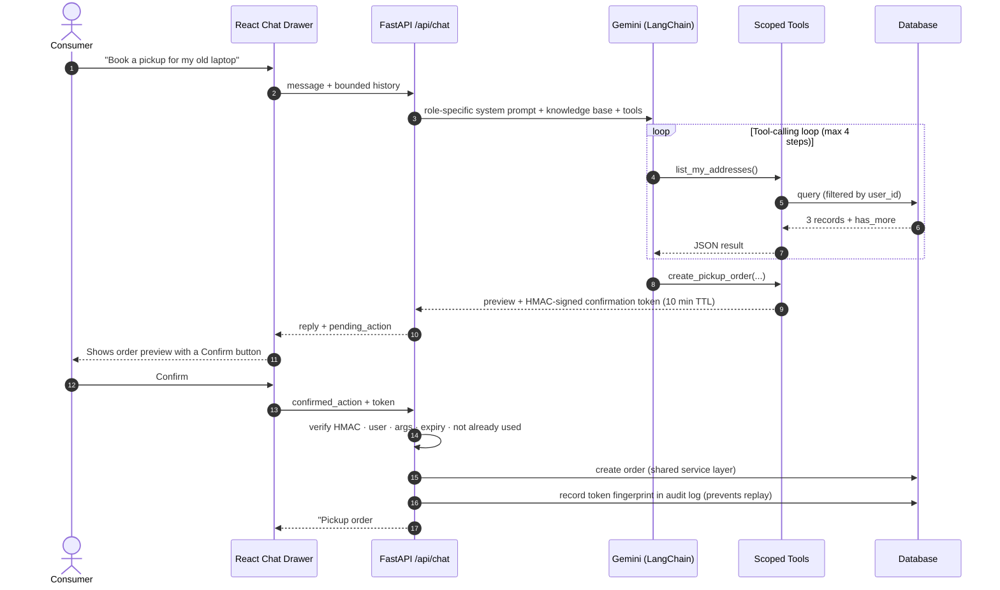
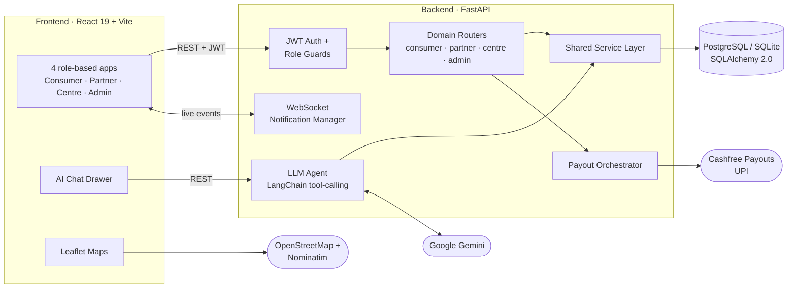
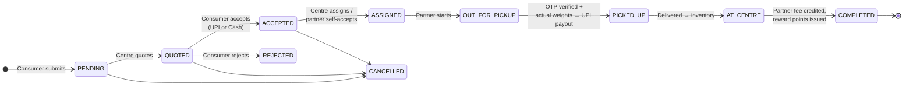

<div align="center">

# ♻️ Reloop

### Full-stack e-waste logistics platform with an LLM agent that takes real actions safely

**Consumers schedule pickups · Centres quote & process · Partners collect · Admins run the platform**<br/>
Includes a tool-calling Gemini assistant, real-time UPI payouts, live maps, and WebSocket notifications.

[](#-tech-stack)
[](#-tech-stack)
[](#-tech-stack)
[](#-the-ai-agent)
[](#-the-ai-agent)
[](#-tech-stack)
[](#-quick-start)
[](#-testing)

### 🌐 [Live Demo → Click here to experience the Platform](https://ewaste-frontend-lc20.onrender.com/)

<sub>Hosted on Render's free tier, so the first load can take up to a minute while the server wakes up.</sub>

[The AI Agent](#-the-ai-agent) · [Architecture](#-architecture) · [Features](#-features-by-role) · [Engineering Decisions](#-engineering-decisions) · [Quick Start](#-quick-start)

</div>

---

## 📌 Overview

India produces millions of tonnes of e-waste a year, and most of it goes through informal channels with no price transparency, no traceability, and no proof it was recycled responsibly.

**Reloop** connects the whole chain on one platform. A household books a pickup, a segregation centre in their city quotes a price, a pickup partner collects it after OTP verification, the consumer gets paid over UPI, and every item is tracked into the warehouse and out to a licensed recycler.

This is a working product, not a CRUD demo:

| | |
|---|---|
| 🤖 **Agentic AI assistant** | Gemini + LangChain with **14 tools**. It can read and change real user data, and every change goes through a **signed, expiring, single-use confirmation step** |
| 👥 **4 role-based apps in one** | Consumer, Pickup Partner, Segregation Centre, and Admin, each with its own dashboard and permissions |
| 💸 **Real money movement** | Automatic **UPI payouts** through the Cashfree Payouts API, plus partner wallets, retries, and status reconciliation |
| 🔄 **8-stage state machine** | Every request moves through a controlled lifecycle with an audit trail, OTP handover, and recalculation from actual weights |
| ⚡ **Real-time** | WebSocket push notifications authenticated with the same JWT as the REST API |
| 🧪 **Well tested** | 160+ pytest tests, including full end-to-end lifecycle tests and security tests for the AI agent |

> **Scale:** about 79 REST/WebSocket endpoints · 20 SQLAlchemy models · 45+ React routes · Docker + Render one-click deploy

---

## 🤖 The AI Agent

The most interesting engineering in this project is the **in-app assistant**. Answering FAQs with an LLM is easy. Letting an LLM **create, update, and cancel real orders** without it ever acting on its own, leaking another user's data, or being replayed is much harder. This agent was built for that second case.

### How it works



### What makes it safe enough for production

| Problem | How it's solved |
|---|---|
| **The LLM must not write to the database directly** | Write tools only return a *preview* plus a confirmation token. The server performs the write only after the user explicitly confirms |
| **Tampered or forged actions** | Tokens are **HMAC-SHA256** over `(user_id, exact arguments, expiry)`. If any argument changes, verification fails. Comparison uses constant-time `hmac.compare_digest` |
| **Replay attacks** | A SHA-256 fingerprint of each used token is written to the audit log, and reused tokens are rejected |
| **Cross-user data access** | Tools are built **per request**, with the authenticated user's DB session and ID captured in a closure. Every lookup goes through an ownership check |
| **Role escalation** | Only consumers get tools. Partners, centres, and admins get a knowledge-only assistant with a separate system prompt. Confirmations from non-consumers return `403` |
| **Hallucinated data** | The system prompt treats tool results as authoritative and forbids inventing IDs, prices, statuses, or addresses |
| **Context and cost growth** | Chat history is capped at 20 messages and bulk tools return **3 records at a time** with `has_more`. The agent asks before loading more |
| **Internal details leaking into replies** | Replies are post-processed to replace tool names, JSON keys, and pagination fields with plain language |
| **Duplicated business logic** | The agent calls the **same service layer** as the REST API (`services/consumer_requests.py`), so validation rules can't drift apart |
| **Model failures** | Tool exceptions are caught and returned to the model as safe error messages. Gemini outages return a clean `502` without leaking internals |

### Agent toolset

| Read tools | Write tools (confirmation required) |
|---|---|
| `list_my_addresses` · `list_available_categories` · `list_my_orders` · `get_my_order` · `get_my_impact` · `get_my_earnings` · `list_my_support_tickets` · `summarize_my_support_tickets` | `create_pickup_order` · `update_order` · `cancel_order` · `remove_order` · `create_support_ticket` · `update_support_ticket` |

Tool inputs are validated with **Pydantic schemas**. The model is configurable through `GEMINI_MODEL` and runs at `temperature=0.2` for consistent tool use. General questions are answered from a curated domain **knowledge base** (pricing, data-wiping guidance, service areas, process) that is injected into the system prompt.

---

## 🏗 Architecture



### Request lifecycle



Every transition is role-checked, written to a per-request timeline, and pushed to the relevant users over WebSocket.

---

## ✨ Features by role

<details open>
<summary><b>🏠 Consumer</b></summary>

- **Map-based address picker**: drop a pin and the street, pincode, and coordinates are filled in through reverse geocoding
- List items by category with **dimensions (L×B×H) and photos**, so partners know what vehicle the job needs
- Choose **Standard or Priority** pickup, then accept or reject the centre's itemised quotation
- Choose **UPI**, which pays out automatically at pickup, or **Cash**
- **My Impact**: kg recycled, estimated CO₂e avoided, reward points, and milestone badges
- Downloadable **recycling certificate**, one-click **reorder**, a **referral program**, and partner/centre **ratings**
- **AI assistant** that can find orders, book pickups, open support tickets, and summarise earnings in chat
</details>

<details>
<summary><b>🛵 Pickup Partner</b></summary>

- **Job marketplace** showing unassigned jobs in your city that you can self-accept, like a gig-work app
- Availability toggle that is automatically locked while a job is active
- **Google Maps turn-by-turn** deep link from the job detail page
- **OTP handover** at the doorstep, with actual weights entered per item so the payout is recalculated from real data
- **Earnings wallet** (total / paid / pending). The fee is stored per job, so later fee changes don't rewrite history
</details>

<details>
<summary><b>🏭 Segregation Centre</b></summary>

- City-routed incoming requests, an itemised **quotation builder**, and partner assignment with ratings shown
- **Warehouse inventory** with a capacity gauge, filled automatically when items are delivered
- **Chain of custody**: dispatch items to a named licensed recycler, then mark them recycled
- **Finance ledger** and analytics dashboards built with Recharts
</details>

<details>
<summary><b>🛡 Admin</b></summary>

- **Revenue analytics** by month and city: material value, handling revenue, partner payouts, and platform commission
- **Payouts console** showing every Cashfree transfer, live status checks, and **retry for failed payouts**
- **Partner balances** with one-click UPI settlement
- Approval workflow for partners and centres, plus user management
- Live **platform settings** (service cities, fees, commission %) that take effect without a restart
- Category pricing with CO₂e factors, an **audit log** of every sensitive action, and a support inbox
</details>

<details>
<summary><b>🌐 Platform-wide</b></summary>

- Real-time WebSocket notifications with unread badges
- Dark and light mode, a responsive layout (sidebar on desktop, bottom navigation on mobile), and searchable paginated tables
- Marketing site: Home, How It Works, Pricing, Impact, FAQ, Contact, Privacy, Terms
</details>

---

## 🧠 Engineering Decisions

- **Server-side human-in-the-loop instead of trusting the prompt.** The prompt tells the model to ask for confirmation, but the *server* enforces it. Even if the model is jailbroken, the most it can produce is a preview.
- **One service layer for both REST and AI.** Order create, update, and cancel logic lives in `services/consumer_requests.py` and is shared by the HTTP routes and the agent tools. The agent can't bypass validation the UI enforces.
- **Values stored at the time of the transaction.** Platform commission and partner pickup fee are copied onto each request when it is processed, so admins can change pricing without rewriting past revenue.
- **Actual weight over estimate.** Partner-weighed values replace consumer estimates for payout calculation, and the agent reports which source a number came from (`actual` or `estimate`).
- **Fail fast in production.** The app refuses to start without `SECRET_KEY` in production instead of falling back to a development secret.
- **Secure admin provisioning.** Admin accounts can't be created through the public registration API. They are provisioned from environment variables at startup or with a reset script.
- **City-based tenancy.** Centres only see requests in their city, and partners can only be assigned within it.
- **Zero-setup local development, Postgres in production.** SQLite runs locally with no configuration, and PostgreSQL is used on Render. A lightweight additive schema upgrader runs on startup.

---

## 🛠 Tech Stack

| Layer | Technologies |
|---|---|
| **AI / LLM** | LangChain (tool calling), `langchain-google-genai`, Google Gemini, Pydantic tool schemas, HMAC-signed action tokens |
| **Backend** | FastAPI, SQLAlchemy 2.0, Pydantic v2, PyJWT, passlib/bcrypt, WebSockets, httpx |
| **Frontend** | React 19, Vite 8, React Router 7, Tailwind CSS, Recharts, Leaflet / react-leaflet, Axios, react-markdown |
| **Data** | PostgreSQL (production), SQLite (development) |
| **Payments** | Cashfree Payouts API (UPI transfers to consumers and partners) |
| **Maps** | OpenStreetMap tiles, Nominatim geocoding, Google Maps deep links |
| **DevOps** | Docker, Docker Compose, Render Blueprint (`render.yaml`) |
| **Quality** | pytest + pytest-cov, oxlint |

---

## 🚀 Quick Start

### Option A: Docker (recommended)

```bash
git clone https://github.com/rafrafreza/Reloop-E-Waste-Logistics-Platform.git
cd Reloop-E-Waste-Logistics-Platform

export GOOGLE_API_KEY="your_gemini_api_key"
export SECRET_KEY="a_long_random_string"

docker compose up --build -d
```

| Service | URL |
|---|---|
| Web app | http://localhost:5173 |
| API | http://localhost:8000 |
| Swagger docs | http://localhost:8000/docs |

### Option B: Manual setup

**Backend** (Python 3.11+)
```bash
cd backend
python -m venv venv
source venv/bin/activate          # Windows: venv\Scripts\activate
pip install -r requirements.txt

export GOOGLE_API_KEY="your_gemini_api_key"
export SECRET_KEY="a_long_random_string"
uvicorn app.main:app --reload --port 8000
```

**Frontend** (Node 18+)
```bash
cd frontend
npm install
npm run dev
```

On first start the database is created automatically and an admin account is provisioned from `ADMIN_EMAIL` / `ADMIN_PASSWORD`. Register consumer, partner, and centre accounts from `/register`, then approve partners and centres from **Admin → Users**.

### Environment variables

| Variable | Required | Description |
|---|---|---|
| `SECRET_KEY` | ✅ (production) | Signs JWTs, WebSocket auth, and AI confirmation tokens |
| `GOOGLE_API_KEY` | ✅ for AI | Gemini API key |
| `GEMINI_MODEL` | — | Override the default Gemini model |
| `DATABASE_URL` | — | Defaults to SQLite. Set a PostgreSQL URL for production |
| `ADMIN_EMAIL` / `ADMIN_PASSWORD` | — | Admin account provisioned at startup |
| `CASHFREE_CLIENT_ID` / `CASHFREE_CLIENT_SECRET` | — | Cashfree credentials, required for UPI payouts |
| `FRONTEND_URL` | — | Allowed CORS origin (set automatically on Render) |
| `VITE_API_URL` | — | Backend URL used by the frontend |

---

## 🧪 Testing

```bash
cd backend
pytest tests/ -v --cov=app
```

The suite has **160+ tests** across 13 modules. Each run uses an isolated SQLite database.

- **Full lifecycle tests**: request → quote → accept → assign → OTP → pickup → centre → complete
- **AI agent tests**: role-restricted prompts and tools, preview-only writes, forged or invalid confirmations, and cross-user data isolation
- **Payout tests**: Cashfree success, failure, and cash paths
- Auth, role guards, uploads, support, admin settings, and partner availability rules

Frontend: `npm run lint` (oxlint) and `npm run build`.

---

## ☁️ Deployment

The repository includes a **Render Blueprint** (`render.yaml`) that sets up the whole stack in one step:

1. A managed **PostgreSQL** database
2. The **FastAPI backend** as a Docker web service, with `SECRET_KEY` generated automatically
3. The **React frontend** as a static site, connected to the backend URL automatically

Add `GOOGLE_API_KEY`, `ADMIN_EMAIL`, `ADMIN_PASSWORD`, and (optionally) the Cashfree keys in the Render dashboard.

---

## 📂 Project Structure

```
backend/
├── app/
│   ├── main.py                 # App factory, CORS, startup provisioning
│   ├── models.py               # 20 SQLAlchemy models
│   ├── auth.py                 # JWT, hashing, role dependencies
│   ├── cashfree.py             # Cashfree Payouts client
│   ├── cashfree_payout.py      # Consumer & partner payout orchestration
│   ├── websocket.py            # Real-time notification manager
│   ├── knowledge_base.md       # Domain knowledge used by the assistant
│   ├── services/
│   │   └── consumer_requests.py  # Shared logic used by REST and the AI agent
│   └── routers/                # auth · consumer · partner · centre · admin
│                               # chat (AI agent) · support · uploads · ws
├── tests/                      # 160+ pytest tests
└── reset_admin.py              # Admin recovery script
frontend/
└── src/
    ├── pages/                  # public · auth · consumer · partner · centre · admin
    ├── components/             # AIChatDrawer, MapPicker, Timeline, PaginatedList, …
    ├── context/                # Auth, Theme, WebSocket providers
    └── api/                    # Axios client + endpoint functions
```

---

## 🗺 Roadmap

- [ ] Webhook-based payout reconciliation with signature verification
- [ ] Retrieval with a vector index over the knowledge base as it grows
- [ ] Agent evaluation suite (tool-selection accuracy, refusal behaviour, regression prompts)
- [ ] SMS delivery for handover OTPs
- [ ] Alembic migrations and a Redis/Celery background job queue
- [ ] Playwright end-to-end UI tests and i18n

---


<div align="center">

**If you found this project interesting, consider giving it a ⭐**

</div>
